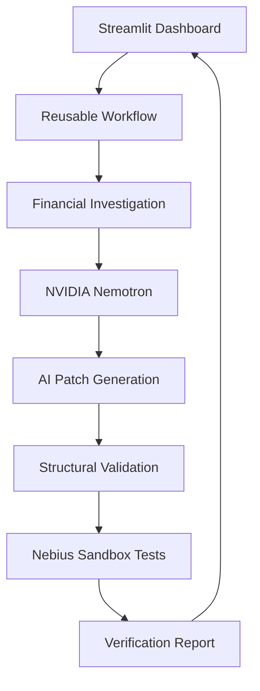

# RootCause AI

**Autonomous Financial Software Debugging**

RootCause AI is an AI-assisted system that investigates financial software errors, identifies potential root causes, generates proposed Python code repairs, and verifies them using isolated Nebius Sandboxes.

Built for the Nebius x NVIDIA AI Hackathon.

## Live Demo

Try RootCause AI:
https://root-cause-ai-1.streamlit.app/

Select a financial debugging scenario and click **Analyze & Repair** to see the AI investigation, generated repair, and independent sandbox verification.


## The Problem

Financial calculation bugs can lead to duplicate payments, incorrect refunds, and inaccurate transaction totals.

Developers often need to investigate transaction data, inspect source code, identify the bug, implement a fix, and test it.

RootCause AI demonstrates how AI can assist with this process while keeping verification separate from AI-generated explanations.

## How RootCause AI Works

1. **Financial Investigation:** Analyze synthetic transactions to identify discrepancies.
2. **AI Diagnosis:** Use NVIDIA Nemotron through Nebius Token Factory to investigate the source code.
3. **Patch Generation:** Generate a proposed Python code repair.
4. **Structural Validation:** Check that the proposed patch targets the expected function and file.
5. **Sandbox Verification:** Run financial regression tests inside disposable Nebius Sandboxes.
6. **Results Dashboard:** Display discrepancies, AI explanations, proposed code changes, and verification results.

## Supported Scenarios

| Scenario | Financial Problem | Regression Tests |
|---|---|---|
| Duplicate transaction processing | Duplicate payments inflate transaction totals | 6 |
| Incorrect refund calculation | Refunds are incorrectly calculated | 7 |

## Technology Stack

- Python
- NVIDIA Nemotron via Nebius Token Factory
- Nebius Sandboxes and Contree CLI
- Streamlit
- Python unittest
- Git and GitHub

## Project Architecture



## Running Locally

Follow these instructions to run RootCause AI on your computer.

### 1. Prerequisites

Before starting, make sure you have:

- Python 3.12 or later
- Git
- A Nebius account
- A Nebius API key with access to NVIDIA Nemotron
- A Nebius Project ID with Sandbox access

### 2. Clone the Repository

Open your terminal and run:

```bash
git clone https://github.com/StarbabyEsther/ROOT-CAUSE-AI.git
cd ROOT-CAUSE-AI
```

### 3. Create a Virtual Environment

```bash
python -m venv .venv
```

Activate the environment.

For Windows PowerShell:

```powershell
.venv\Scripts\Activate.ps1
```

For macOS/Linux:

```bash
source .venv/bin/activate
```

### 4. Install Dependencies

```bash
python -m pip install -r requirements.txt
```

This installs Streamlit, the OpenAI-compatible API client,
python-dotenv, and Contree CLI.

### 5. Configure Nebius Credentials

RootCause AI uses NVIDIA Nemotron through Nebius Token Factory
and Nebius Sandboxes for independent code verification.

Create a file named `.env` in the project's root directory.

Add the following configuration:

```env
NEBIUS_API_KEY=your_api_key_here
NEBIUS_MODEL=your_nemotron_model_here
CONTREE_PROJECT_ID=your_project_id_here
```

Replace the placeholders with your own Nebius credentials.

**Security:** Never upload your `.env` file, API keys, or
authentication tokens to GitHub.

### 6. Authenticate Nebius Sandbox

RootCause AI uses Nebius Sandboxes through Contree CLI
to execute regression tests in isolated environments.

Run:

```bash
contree auth
```

Select IAM authentication and provide your Nebius Project ID
and API token when prompted.

Once authentication succeeds, Contree saves an authentication
profile that allows the application to execute sandbox tests.

### 7. Start RootCause AI

Run:

```bash
python -m streamlit run streamlit_app.py
```

Open the local URL displayed in your terminal.

### 8. Run an Investigation

1. Open the Streamlit dashboard.
2. Select a financial debugging scenario.
3. Click **Analyze & Repair**.
4. Review the financial discrepancy and AI investigation.
5. Examine the proposed code repair.
6. Review the Nebius Sandbox verification results.

### 9. Run Automated Tests

To run the reusable workflow tests:

```bash
python -m unittest test_workflow.py -v
```

Financial regression tests are also executed inside Nebius
Sandboxes during the repair verification process.
The workflow tests cover successful verification, failed repairs, blocked execution, corrupted reports, and unsupported scenarios.

## Verification and Limitations

- Demonstration scenarios use synthetic financial data.
- Original source files are preserved during sandbox verification.
- AI-generated patches undergo structural validation.
- Candidate repairs are tested in disposable sandbox environments.
- Passing regression tests does not prove correctness for all possible inputs.
- This is a hackathon prototype, not production-ready financial software.

## Team
Developed collaboratively by Esther and Juliana for the Nebius x NVIDIA AI Hackathon.

**Track:** Coding & Agentic Engineering

## License
This project is licensed under the MIT License. See the `LICENSE` file for details.

Developed collaboratively for the Nebius x NVIDIA AI Hackathon.

