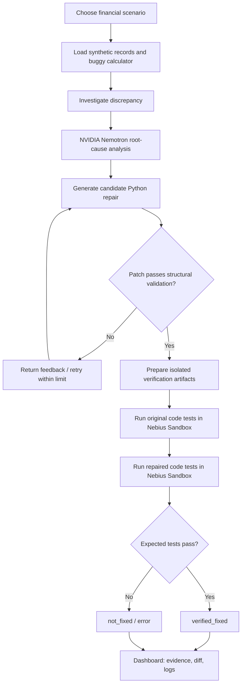
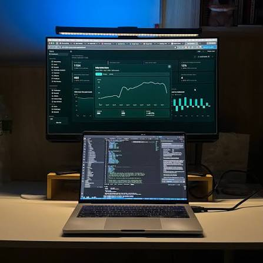

<div align="center">

# RootCause AI
## Detect the discrepancy. Diagnose the code. Generate the fix. Verify the result.

**An AI-assisted financial software debugging system powered by NVIDIA Nemotron and Nebius Sandboxes.**

Built for the **Nebius × NVIDIA AI Hackathon** · **Coding & Agentic Engineering**


## Live Demo

Try RootCause AI:
https://root-cause-ai-1.streamlit.app/

Select a financial debugging scenario and click **Analyze & Repair** to see the AI investigation, generated repair, and independent sandbox verification.

[**Explore the Live Demo**](https://root-cause-ai-1.streamlit.app/) · [**How It Works**](#how-it-works) · [**Run Locally**](#getting-started) · [**Technical Documentation**](TECHNICAL_DOCUMENTATION.md)

</div>


## Financial software can be wrong even when it runs.

A transaction is processed twice. A refund is added instead of subtracted. A seemingly harmless floating-point operation introduces an unexpected decimal value.
The code may execute without crashing, yet the financial result is incorrect.

Investigating these failures usually means tracing transaction records, inspecting calculation logic, proposing a fix, and establishing that the correction works. An AI-generated explanation can accelerate that process, but **a plausible explanation is not proof of a correct repair**.

RootCause AI closes that gap between suggesting a fix and testing one. It combines financial anomaly investigation, model-assisted code repair, and independently executed regression tests in disposable sandboxes. The original application source remains unchanged during the verification process.

**Our design principle:** 
Trust the evidence from execution, not the confidence of the generated answer.

## Proof of concept: three bugs, three verified repairs

Our deployed Streamlit application successfully demonstrated three predefined financial debugging scenarios. Across these scenarios, the original implementations produced 10 failing regression tests. After Nemotron-generated repairs were independently verified in Nebius Sandboxes, all 18 regression tests passed.


| Scenario | Initial failing tests | Tests passing after AI repair | Result |
| :--- | ---: | ---: | :--- |
| Duplicate transaction processing | 3 of 6 | **6 / 6** | verified_fixed |
| Incorrect refund calculation | 3 of 7 | **7 / 7** | verified_fixed |
| Monetary precision error | 4 of 5 | **5 / 5** | verified_fixed |
| **Total** | **10 initial test failures** | **18 / 18 passing tests** | **3 verified scenarios** |


**What do these numbers mean?** 
Each original implementation failed part of its scenario-specific regression suite. After Nemotron-generated candidate repairs were executed inside Nebius Sandboxes, all 18 tests passed across the three repaired scenarios.

These are **observed results for a small, predefined test suite**, not a general accuracy benchmark or a guarantee of correctness on unseen software.

### A real investigation, step by step

In the duplicate-processing scenario, a transaction with ID TXN002 is mistakenly included twice:

| Investigation signal | Observed value |
| :--- | ---: |
| Total calculated by buggy code | **$600.00** |
| Correct transaction total | **$400.00** |
| Financial discrepancy | **$200.00** |
| Duplicate transaction ID | TXN002 |
| Original regression tests | **3 failures / 6 tests** |
| Repaired regression tests | **6 passed / 6 tests** |

RootCause AI investigates the discrepancy, uses NVIDIA Nemotron to propose a targeted change to `calculate_total()`, checks the patch structure, and runs the original and repaired implementations against regression tests in separate sandbox executions.

The result is a traceable **verified_fixed** verdict, not just an AI-written recommendation.

---


## What makes RootCause AI different?

| Typical debugging assistance | RootCause AI's approach |
| :--- | :--- |
| Describes what might be wrong | Investigates transaction data **and** calculation logic |
| Suggests a code snippet | Produces a **targeted candidate repair** for an expected function |
| Leaves validation to the developer | Executes **baseline and repaired-code tests** in Nebius Sandboxes |
| Reports a confident explanation | Reports an explicit **verification verdict**, test counts, and execution evidence |
| May modify a working copy during experimentation | Preserves the original source while preparing a separate repair artifact |

RootCause AI is **AI-assisted**, not an unrestricted autonomous production code editor: it currently operates on supported scenarios and constrained function-level patches.

That's deliberate—verification and scope control are part of the product design.


## How it works


### The six-stage investigation

1. **Financial investigation** Calculate the observed and expected totals, inspect affected transactions, and characterize the discrepancy.

2. **AI diagnosis** Ask **NVIDIA Nemotron**, via Nebius Token Factory, to analyze the failure and identify its likely root cause.

3. **Patch generation** Generate a proposed replacement for the relevant Python calculation function.

4. **Structural validation** Parse the candidate with Python's AST tools and reject patches that violate expected structural constraints.

5. **Independent sandbox verification** Run original and candidate-repaired code against scenario-specific regression tests in disposable **Nebius Sandboxes**, accessed through the **ConTree CLI**.

6. **Evidence-based reporting** Display the financial mismatch, diagnosis, proposed code, verification counts, before/after diff, and execution logs.

The AI's explanation does **not** determine the verification verdict. The result depends on the executed checks.

---

## Supported financial scenarios

### 01 · Duplicate transaction processing

**Failure:**  Repeated transaction IDs are counted more than once, inflating the reported balance.

**Example:**  A duplicated $200 payment changes a $400 correct total into $600.

**What is verified:**  Deduplication behavior, duplicate payment/refund handling, empty inputs, and preservation of input records.

**Regression suite:**  6 tests.

### 02 · Incorrect refund calculation

**Failure:**  The calculator adds a refund to the total instead of subtracting it.

**Example:**  An incorrect total of $300 versus a correct $200 total creates a $100 discrepancy.

**What is verified:**  Refund handling, mixed transactions, multiple refunds, payments-only inputs, empty inputs, and protection against unintended input modification.

**Regression suite:**  7 tests.

### 03 · Monetary precision errors

**Failure:**  Binary floating-point arithmetic produces unexpected decimal representations in financial calculations.

**Example:**  0.1 + 0.2 can evaluate to 0.30000000000000004, instead of an exact decimal 0.30.

**What is verified:**  Decimal accuracy across payments, multiple payments, refunds, original records, and empty inputs. The candidate repair uses decimal-safe arithmetic and is tested rather than assumed correct.

**Regression suite:**  5 tests.

---


## Experience RootCause AI
### Live demonstration

**[Launch the RootCause AI demo](https://root-cause-ai-1.streamlit.app/)**

The app lets you select a supported financial failure; initiate **Analyze & Repair**, and inspect:

•	The detected financial discrepancy and affected records
•	Nemotron's structured diagnosis and proposed correction
•	The generated Python patch and source-code diff
•	Baseline failures and repaired-code test results
•	Nebius Sandbox execution evidence and final verdict
The redesigned Streamlit V2 interface includes a welcome experience, an Investigation Lab, a How It Works section, and Day/Night appearance options.





### A suggested 60-second demo

1. Open the **Investigation Lab** and choose **Duplicate transaction processing**.
2. Show the **$200 discrepancy** and duplicate transaction TXN002.
3. Click **Analyze & Repair** to generate the candidate fix.
4. Open the **before/after code diff** to show what changed.
5. Show the independent sandbox evidence: **3 original test failures → 6 repaired tests passing**.
6. Repeat briefly with **refunds** and **precision errors** to demonstrate that the system handles more than one class of defect.

The scenarios use **synthetic demonstration data**. No real bank accounts, customer balances, or live production payment systems are connected.
---

## Technical architecture

RootCause AI separates **financial analysis**, **AI code generation**, **validation**, **isolated execution**, and **presentation** instead of treating a model response as an unquestionable answer.

| Layer | Technology / module | Responsibility |
| :--- | :--- | :--- |
| Frontend | Streamlit (streamlit_app_v2.py, streamlit_app.py) | Welcome experience, scenario selection, results, code comparisons, logs |
| Scenario orchestration | workflow.py, scenario_registry.py | Route a chosen scenario to its investigation and repair workflow |
| Financial reasoning | financial_investigator.py | Calculate and explain discrepancies from transaction data |
| Model inference | nemotron_client.py; Nebius Token Factory | Structured NVIDIA Nemotron diagnosis |
| Repair generation | patch_generator.py, repair_agent.py, scenario-specific repair runners | Generate candidate function-level patches and bounded retries |
| Patch checks | patch_validator.py and scenario-specific AST checks | Validate syntax and intended structural scope |
| Test preparation | prepare_sandbox_tests.py and scenario-specific bundles | Prepare isolated baseline and repaired test inputs |
| Execution | sandbox_verifier.py, ConTree CLI, Nebius Sandboxes | Run regression tests in disposable VM-isolated environments |
| Evidence | JSON verification reports and execution logs | Expose reproducible test outcomes and repair artifacts |


## Technology Stack

- Python
- NVIDIA Nemotron via Nebius Token Factory
- Nebius Sandboxes and Contree CLI
- Streamlit
- Python unittest
- Git and GitHub
The configured model for the demonstrated environment is `nvidia/Nemotron-3_5-Lightning`.
Model availability depends on the Nebius account and endpoint configuration.


### Key project files

```text
ROOT-CAUSE-AI/
├── streamlit_app_v2.py           # Redesigned demo website
├── streamlit_app.py              # Original Streamlit interface
├── workflow.py                   # Scenario workflow orchestration
├── scenario_registry.py          # Supported scenario definitions
├── financial_investigator.py     # Financial discrepancy analysis
├── nemotron_client.py            # Nebius/Nemotron connection
├── main.py                       # Duplicate-transaction workflow
├── patch_generator.py            # AI patch generation
├── patch_validator.py            # Function-level validation
├── repair_agent.py               # Bounded duplicate repair attempts
├── sandbox_verifier.py           # Duplicate scenario sandbox verification
├── prepare_sandbox_tests.py      # Isolated test preparation
├── refund_processor.py           # Intentionally faulty refund example
├── refund_ai_repair.py           # Refund repair workflow
├── precision_processor.py        # Intentionally faulty precision example
├── precision_ai_repair.py        # Precision repair workflow
├── test_refund_processor.py      # Refund regression tests
├── test_precision_processor.py   # Precision regression tests
├── test_workflow.py              # Orchestration tests
├── test_scenario_registry.py     # Registry tests
├── TECHNICAL_DOCUMENTATION.md    # Additional engineering documentation
├── requirements.txt
├── .streamlit/config.toml
└── assets/
    ├── rca_hero.jpg
    └── rca_workspace.jpg
```

For deeper implementation details, see **[Technical Documentation](TECHNICAL_DOCUMENTATION.md)**.

---

## Getting started

### 1. Prerequisites

•	Python **3.12 or later** (3.12 is the sandbox image used in the demonstrated workflow)
•	Git
•	A Nebius account with access to **NVIDIA Nemotron through Token Factory**
•	A Nebius project enabled for **Sandboxes**
•	An API key with the required access

### 2. Clone the repository
```bash
git clone https://github.com/StarbabyEsther/ROOT-CAUSE-AI.git
cd ROOT-CAUSE-AI
```

### 3. Create a virtual environment
```bash
python -m venv .venv
```
**Windows PowerShell**
```powershell
.\.venv\Scripts\Activate.ps1
```
**macOS / Linux**
```bash
source .venv/bin/activate
```

### 4. Install dependencies
```bash
python -m pip install -r requirements.txt
```
Make sure `requirements.txt` includes the dependencies used by the current checkout, including Streamlit, the OpenAI-compatible client, python-dotenv, and contree-cli.

### 5. Configure Nebius credentials
Create a private `.env` file in the project root:
```dotenv
NEBIUS_API_KEY=your_nebius_token_factory_api_key
NEBIUS_MODEL=nvidia/Nemotron-3_5-Lightning
CONTREE_PROJECT_ID=your_nebius_project_id
```
The project ID is the Nebius **project identifier** (such as an `aiproject-...` value), **not** a local ConTree sandbox session ID.

**Never commit `.env`, API keys, saved ConTree authentication profiles, or private credentials to GitHub.**

### 6. Authenticate ConTree for sandbox execution
```bash
contree auth
```
Choose **IAM authentication** and provide your Nebius project ID and API token when prompted.

ConTree stores a local authentication profile for subsequent sandbox commands.

You can confirm that the profile can access images with:
```bash
contree images --prefix python
```
ConTree also supports environment-variable fallbacks during authentication registration.

See the [official ConTree CLI documentation](https://github.com/nebius/contree-cli) for current options and configuration behavior.

### 7. Launch the website

**Redesigned V2 interface:**
```bash
python -m streamlit run streamlit_app_v2.py
```
**Original dashboard:**
```bash
python -m streamlit run streamlit_app.py
```
Open the local URL printed by Streamlit, select a scenario, and click **Analyze & Repair**.

To access hosted AI and sandbox services, your credentials and Nebius project permissions must be valid.

### 8. Run automated tests
```bash
python -m unittest test_workflow.py -v
python -m unittest test_scenario_registry.py -v
```
The financial regression suites are also run by the repair workflows inside Nebius Sandboxes.

To reproduce the monetary precision baseline locally without performing an AI repair:
```bash
python -m unittest test_precision_processor.py -v
```
**Expected:**  The intentionally buggy implementation produces failing regression tests. That failure is part of the demonstration, not evidence that the original code has been fixed.

---

## Deployment

The web interface is deployed through **[Streamlit Community Cloud](https://share.streamlit.io/)** using this GitHub repository.

| Setting | Recommended value |
| :--- | :--- |
| Repository | StarbabyEsther/ROOT-CAUSE-AI |
| Branch | The branch containing the tested release (verify in Streamlit Cloud settings) |
| App entrypoint | Confirm the deployed entrypoint in Streamlit Cloud settings (`streamlit_app_v2.py` or `streamlit_app.py`) |
| Python | 3.12 |
| Secrets | NEBIUS_API_KEY, NEBIUS_MODEL, CONTREE_PROJECT_ID |

**Deployment verification:** The deployed Streamlit application has successfully completed all three supported financial debugging workflows, including Nemotron-generated repairs and Nebius Sandbox verification.

The hosted process must have a usable ConTree authentication profile and permission to reach Nebius Sandboxes; the successful local setup on a developer's laptop does not automatically transfer to Streamlit Cloud.

Credential injections, dependency installation, timeouts, and sandbox access should all be checked on the hosted environment.

Streamlit apps using shared report paths should also be **isolated per investigation/request** before enabling concurrent public use.

Add request limits and resource controls to protect API quotas and avoid unrelated users overwriting results.

---

## Verification model and limitations

The project intentionally distinguishes **a generated patch**, **a structurally valid patch**, and **a patch verified against a specific test suite**.

•	**Synthetic data:**  The current scenarios use predefined, synthetic records.
•	**Constrained patch scope:**  Candidate repairs target expected calculation functions. AST checks provide structural guardrails, **not a complete security guarantee**.
•	**Disposable execution:**  Generated code is exercised in Nebius Sandboxes rather than being applied directly to the original project source.
•	**Evidence-bound verdicts:**  verified_fixed means the tested candidate passed the expected regression suite; it does **not** prove correctness for all inputs or financial systems.
•	**Finite coverage:**  Three demonstrated scenarios are not an arbitrary-code repair benchmark.
•	**Deployment considerations:**  multi-user isolation, authentication, quota enforcement, monitoring, and stronger security controls are needed for production use.
**RootCause AI is a hackathon prototype, not production-ready financial software.**

It does not autonomously deploy patches to live financial services or execute real banking transactions.

---

## What's next

Our longer-term vision is a developer tool that makes financial application debugging **more explainable, testable, and auditable**.

Potential next steps are:

1. **Generalized ingestion** of additional calculation modules and developer-supplied test suites.
2. **Stronger evaluation** against more bugs, unseen programs, mutation tests, and reproducible benchmarks.
3. **Reviewable repair workflow** with human approval, versioned artifacts, and integration into CI pipelines.
4. **Production safeguards** such as authentication, per-run isolation, usage controls, and detailed audit trails.

These are **planned extensions**, not features claimed to be complete today.

---

## Team

Built collaboratively by **Esther and Juliana Owokade** for the **Nebius × NVIDIA AI Hackathon**.

**Track:** Coding & Agentic Engineering

## License

MIT License — see [LICENSE](LICENSE) for the full terms.

---

<div align="center">

### AI can propose a repair. RootCause AI asks: **Did it actually work?**

[**Try the Demo**](https://root-cause-ai-1.streamlit.app/) · [**Explore the Code**](https://github.com/StarbabyEsther/ROOT-CAUSE-AI) · [**Read the Technical Docs**](TECHNICAL_DOCUMENTATION.md)

</div>

Developed collaboratively for the Nebius x NVIDIA AI Hackathon.

