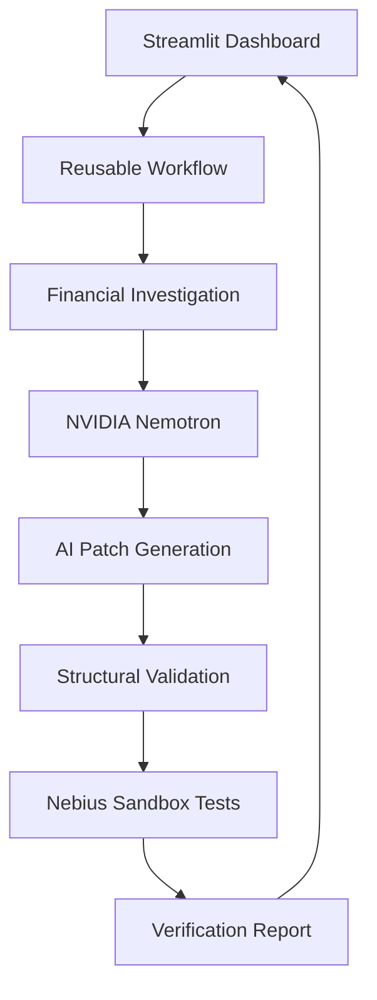

# RootCause AI

**Autonomous Financial Software Debugging**

RootCause AI is an AI-assisted system that investigates financial software errors, identifies potential root causes, generates proposed Python code repairs, and verifies them using isolated Nebius Sandboxes.

Built for the Nebius x NVIDIA AI Hackathon.

## Live Demo

Try RootCause AI:
https://rootcause-ai-demo.streamlit.app/

Select a financial debugging scenario and click **Analyze & Repair** to see the AI investigation, generated repair, and independent sandbox verification.


## The Problem

Financial calculation bugs can lead to duplicate payments, incorrect refunds, and inaccurate transaction totals.

Developers often need to investigate transaction data, inspect source code, identify the bug, implement a fix, and test it.

RootCause AI demonstrates how AI can assist with this process while keeping verification separate from AI-generated explanations.

## How RootCause AI Works

1. **Financial Investigation:** Analyze synthetic transactions to identify discrepancies.
2. **AI Diagnosis:** Use NVIDIA Nemotron through Nebius Token Factory to investigate the source code.
3. **Patch Generation:** Generate a proposed Python code repair.
4. **Structural Validation:** Check that the proposed patch targets the expected function and file.
5. **Sandbox Verification:** Run financial regression tests inside disposable Nebius Sandboxes.
6. **Results Dashboard:** Display discrepancies, AI explanations, proposed code changes, and verification results.

## Supported Scenarios

| Scenario | Financial Problem | Regression Tests |
|---|---|---|
| Duplicate transaction processing | Duplicate payments inflate transaction totals | 6 |
| Incorrect refund calculation | Refunds are incorrectly calculated | 7 |

## Technology Stack

- Python
- NVIDIA Nemotron via Nebius Token Factory
- Nebius Sandboxes and Contree CLI
- Streamlit
- Python unittest
- Git and GitHub

## Project Architecture



## Running Locally

Install the project dependencies:

```bash
python -m pip install -r requirements.txt
```

Configure the required Nebius credentials securely. Do not commit API keys or `.env` files.

Start the Streamlit dashboard:

```bash
python -m streamlit run streamlit_app.py
```

The complete repair workflow requires working Nebius Token Factory access and Nebius Sandbox authentication.

## Automated Testing

Run the reusable workflow tests:

```bash
python -m unittest test_workflow.py -v
```

The workflow tests cover successful verification, failed repairs, blocked execution, corrupted reports, and unsupported scenarios.

## Verification and Limitations

- Demonstration scenarios use synthetic financial data.
- Original source files are preserved during sandbox verification.
- AI-generated patches undergo structural validation.
- Candidate repairs are tested in disposable sandbox environments.
- Passing regression tests does not prove correctness for all possible inputs.
- This is a hackathon prototype, not production-ready financial software.

## Team

Developed collaboratively for the Nebius x NVIDIA AI Hackathon.

