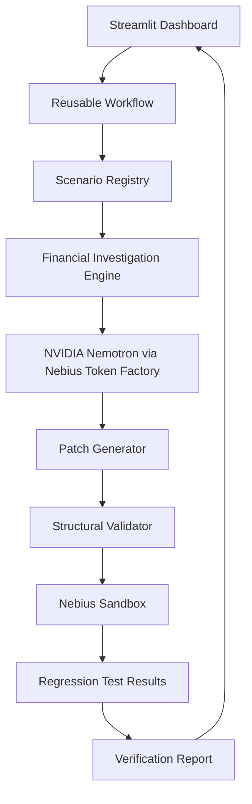

# RootCause AI — Technical Documentation

## 1. System Overview

RootCause AI is an AI-assisted financial software debugging prototype.

It combines deterministic financial investigation, NVIDIA Nemotron-generated repair proposals, structural code validation, and isolated regression testing.

The system currently supports two synthetic financial scenarios.

## 2. Architecture

## 3. Main Components

### Scenario Registry
`scenario_registry.py`

Maps supported scenario identifiers to their transaction records, calculator functions, and source files.

### Financial Investigation
`financial_investigator.py`

Compares actual transaction totals with independently calculated expected totals.

Identifies potential duplicate processing and refund calculation errors.

### AI Integration
`nemotron_client.py`

Connects to NVIDIA Nemotron through Nebius Token Factory to support code investigation.

### Patch Generation and Validation
`patch_generator.py`, `patch_validator.py`, and `refund_ai_repair.py`

Generate proposed repairs and check their structure before verification.

### Sandbox Verification
`sandbox_verifier.py` and `refund_ai_repair.py`

Execute regression tests in disposable Nebius Sandboxes using Contree.

### Workflow Orchestration
`workflow.py`

Provides a reusable entry point for running supported financial debugging scenarios and collecting their results.

### User Interface
`streamlit_app.py`

Displays investigation findings, AI-generated repair proposals, code differences, and verification results.

## 4. Supported Test Scenarios

| Scenario | Regression Tests | Previously Observed Repair Result |
|---|---:|---|
| Duplicate transactions | 6 | 6 passed |
| Incorrect refunds | 7 | 7 passed |

These results were observed during local development with Nebius Sandbox execution. They are not a guarantee of future execution success.

## 5. Error Handling

The reusable workflow has automated tests covering:

- Unsupported scenario identifiers
- Successful verification reports
- Failed repair execution
- Operating-system execution errors
- Corrupted verification reports

## 6. Security Considerations

- Only synthetic financial data is used in the demonstration.
- AI-generated patches undergo structural validation.
- Original source files are preserved during verification.
- Candidate repairs are executed in remote disposable sandboxes.
- API keys should be supplied through secure environment configuration.
- AST validation alone is not a complete security boundary.
- Sandbox permissions, networking, resource limits, and credential isolation require verification before public deployment.

## 7. Known Limitations

- Only two financial bug scenarios are currently supported.
- Repair verification is limited to the supplied regression tests.
- Nemotron may generate invalid or unsuccessful patches.
- Nebius Sandbox execution depends on authentication and execution policies.
- The prototype is not suitable for processing real financial transactions.

## 8. Future Improvements

- Additional financial bug scenarios
- Broader automated test coverage
- Stronger sandbox security policies
- More detailed progress reporting
- Production-oriented monitoring and audit trails
