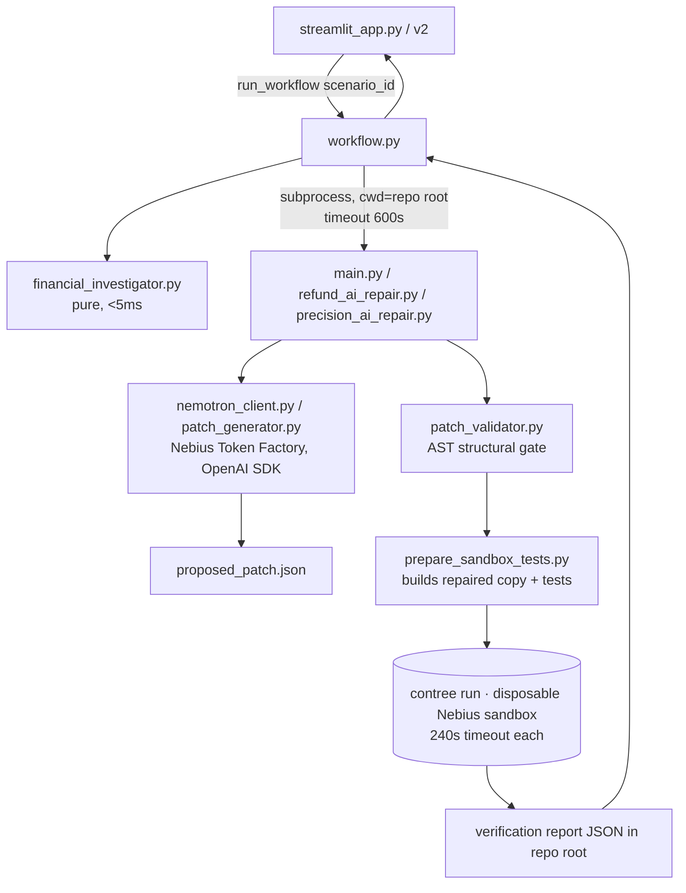

# RootCause AI — Frontend Redesign: Architecture Analysis & Recommendation

**Status:** Proposal only. **No application code has been changed.**
**Branch:** `arena/0eaa482c-root-cause-ai` (branched from `arena-website-redesign` @ `c63b5ed`)
**Date:** 2026-10-26

---

## 1. What I inspected

| Item | Finding |
|---|---|
| Branch state | `arena-website-redesign` is **identical** to `main` at `c63b5ed`. No redesign work exists yet; `arena/0eaa482c-root-cause-ai` is a clean fork with an empty working tree. |
| Backend size | 20 Python modules, ~2,100 LOC backend + ~525 LOC tests. No framework, no HTTP layer, no ORM. |
| Frontends present | `streamlit_app.py` (317 lines, the **deployed** app) and `streamlit_app_v2.py` (384 lines, heavily restyled experiment). |
| Dependencies | `streamlit==1.56.0`, `openai`, `python-dotenv`, `contree-cli` (Nebius sandbox CLI). Nothing else. |
| Generated artifacts | JSON reports written into the **repo root** (`proposed_patch.json`, `*_verification_report.json`, `verification_bundle/`, `refund_verification_bundle/`, `precision_verification_bundle/`). |
| Verified working locally | `import workflow` succeeds **without** credentials; `test_workflow` (5 tests) and `test_scenario_registry` (2 tests) pass. Live runs are **not** reproducible in a clean environment: no `.env`, and the `contree` binary is absent. |

### Execution graph (as-built)



### The real data contract (this is the important part)

Every run produces three JSON-shaped objects. They are **not** consistent across scenarios:

| Field group | duplicate | refund | precision |
|---|---|---|---|
| `scenario_id` in report | `duplicate_transaction` | `refund_sign_error` ⚠️ | `monetary_precision` ✅ |
| `elapsed_seconds` | ✅ | ❌ | ❌ |
| `baseline_passed` | ✅ | ❌ | ❌ |
| `attempts` | ❌ | ✅ | ✅ |
| `verdict` | `verified_fixed` \| `not_fixed` \| `error` | same | same |
| Patch keys | `root_cause`, `explanation`, `target_file`, `proposed_code` | same | same |
| Financial keys (strings) | `issue_detected`, `issue_type`, `duplicate_ids`, `affected_transactions`, `actual_total`, `expected_total`, `discrepancy` | same | same |

Measured financial output today:

| Scenario | Actual | Expected | Discrepancy | Classifier |
|---|---|---|---|---|
| Duplicate transactions | `600.0` | `400.00` | `200.00` | Possible duplicate processing (`TXN002`) |
| Incorrect refunds | `300.0` | `200.00` | `100.00` | Possible refund sign error (`RF002`) |
| Monetary precision | `0.20000000000000004` | `0.20` | `4E-17` | **Unclassified financial discrepancy** ⚠️ |

Two things fall out of this that any redesigned UI must handle:

1. **A normalisation layer is required.** `refund_sign_error` vs `incorrect_refund`, the missing `elapsed_seconds`, and the missing `baseline_passed` will break a typed frontend otherwise.
2. **The precision scenario has an empty `affected_transactions` list and no named root object.** The UI cannot render "these 3 rows are wrong" for it. It needs a dedicated precision visual (float-vs-Decimal value inspector) rather than reusing the transaction table. Also, `4E-17` must be rendered as `−0.00000000000000004` (or "17 orders of magnitude below one cent"), never rounded to `$0.00`.

### Coupling points that constrain any new frontend

| Constraint | Evidence | Consequence |
|---|---|---|
| Backend is a **CLI/process** app, not a service | `subprocess.run([sys.executable, script])` in `workflow.py:56` | A browser app cannot call it directly; something HTTP must exist. |
| Runs are **not concurrency-safe** | Reports are written to fixed filenames at `Path(__file__).parent`; `ROOT` is a module constant | Two simultaneous runs corrupt each other. v2 works around this with an in-process `threading.Lock`. |
| **No progress streaming** | `run_workflow` returns only when the 600s subprocess exits; child stdout is captured, not forwarded | Streamlit shows a single opaque spinner for 30–180s. This is the single biggest UX weakness. |
| **Secrets are process-global** | `patch_generator.py` and `nemotron_client.py` read `NEBIUS_*` at **import time** and `raise RuntimeError` if absent | The API process must own the secrets; a frontend must never see them, and importing those modules without a key is fatal. |
| Verification needs **`contree` CLI + IAM** | `sandbox_verifier.py:authenticate_contree()` | Live runs cannot work on a static host, and cannot work at all in this review sandbox. |
| Test counts are hard-coded per scenario | 6 / 7 / 5 (18 total) | UI copy should read counts from one registry, not hard-code them in JSX. |

---

## 2. The core question: improve Streamlit, or build React?

### Observation: "improve Streamlit" has already been attempted — and is at its ceiling

`streamlit_app_v2.py` is a serious custom redesign: day/night palettes, a two-tone navigation system, custom cards, a 10,160-character inline CSS stylesheet and 15 raw-HTML injections through `st.html`. It gets a decent result, but it does so by:

- targeting Streamlit internals — `[data-testid="stHeader"]`, `[data-testid="stMetric"]`, `[data-testid="stExpander"]`, `button[kind="primary"]` — which are **private, version-specific DOM contracts**. The repo pins `streamlit==1.56.0`, so any version bump silently breaks the styling.
- injecting the whole visual layer as strings inside Python, so there is no design-token system, no component reuse, no type checking, and no way to test the UI.
- still being unable to do the things the brief actually asks for: real route transitions, scroll-driven animation, a live multi-stage agent trace, custom charts/canvas visuals, or shareable per-investigation URLs (`st.session_state` is per-session; a run result cannot be linked to or reloaded).

So the honest framing is not "Streamlit vs React in the abstract" — it is:

> Streamlit's programming model (rerun-the-whole-script, server-side state, one blocking call per button) *is* the limit. Styling it harder buys maybe a 20% aesthetic gain and 0% of the interaction and storytelling gains.

### Option comparison

| | **A. Restyle Streamlit further** | **B. React SPA + thin Python API adapter** ✅ | **C. Full rewrite: React + new backend** |
|---|---|---|---|
| Deep-navy/electric-blue art direction | Achievable but only via CSS hacks against private DOM | Full control (`<canvas>` glow, grain, gradients, motion) | Same as B |
| Cinematic landing page | Impossible inside Streamlit | Yes | Yes |
| Live investigation trace | No (one spinner) | Yes (SSE; see §4.4) | Yes |
| Shareable result URLs | No | Yes (`/investigations/:id`) | Yes |
| Code diff viewer w/ syntax highlighting | `st.code` only | Monaco/Shiki diff, side-by-side, line anchors | Same |
| Per-test pass/fail matrix (6/7/5) | Fake it with metrics | Real component | Same |
| Effort | Low, but diminishing | Medium | High |
| Backend risk | None | **None** — adapter is additive | High — violates "don't modify the backend" |
| Existing Streamlit deploy | Preserved | Preserved (untouched) | At risk |
| Regressions possible in AI repair path | No | No | Likely |

**Rejected: Option C.** Rewriting the investigation engine into a service would touch `workflow.py`, `patch_generator.py`, `sandbox_verifier.py` and the regression tests — directly against the brief. Not worth it; the backend already exposes the perfect seam (`run_workflow(scenario_id) -> dict`).

---

## 3. Recommendation

> **Build a separate React frontend, and keep Streamlit exactly as it is.**
>
> Add two new, purely additive top-level directories — `web/` (React) and `api/` (a thin HTTP adapter) — and change **zero bytes** of the existing Python backend, tests, or `streamlit_app.py`.

This is **Option B**. Rationale, in priority order:

1. **It satisfies every "do not touch" constraint by construction.** The adapter only *imports* `workflow.run_workflow` and reads JSON files. `streamlit_app.py` and `.streamlit/config.toml` remain the Streamlit Cloud deployment untouched — the live demo link keeps working during and after the redesign.
2. **It is the only way to deliver the requested aesthetic.** Design tokens, Framer Motion choreography, canvas/gradient visuals and typography control all require a real CSS/DOM environment.
3. **It unlocks the actual product story.** The differentiator of RootCause AI is not "a form that prints JSON" — it is watching an autonomous agent *investigate → diagnose → patch → sandbox-verify*. A React client can render that as a staged, animated, evidence-backed timeline. Streamlit structurally cannot.
4. **Risk is contained.** If the new frontend underperforms, the Streamlit app is still live and unaffected. There is no migration cliff.

### 3.1 Proposed structure (all new files; nothing existing is edited)

```
ROOT-CAUSE-AI/
├── web/                      # NEW — React 18 + TypeScript + Vite SPA
│   ├── src/
│   │   ├── app/              # router, layout, providers
│   │   ├── design/           # tokens.css, theme.ts, primitives (Button, Card, Glow...)
│   │   ├── features/
│   │   │   ├── landing/      # hero, pipeline visual, trust strip
│   │   │   ├── scenarios/    # 3 scenario cards + precision/refund/duplicate visuals
│   │   │   └── investigation/# stage rail, verdict panel, diff viewer, test matrix, logs
│   │   ├── lib/api.ts        # typed client, SSE consumer
│   │   └── mocks/            # recorded run fixtures (replay mode)
│   └── (vite.config.ts, tailwind config, package.json)
├── api/                      # NEW — FastAPI adapter, ~300 LOC
│   ├── main.py               # routes, CORS, SSE
│   ├── jobs.py               # per-run temp workspace + concurrency guard
│   ├── schemas.py            # Pydantic models = the normalised contract
│   ├── redact.py             # scrubs NEBIUS_API_KEY / CONTREE_TOKEN from logs
│   └── requirements-api.txt  # fastapi, uvicorn, pydantic (additive)
├── docs/frontend-architecture-proposal.md   # this file
└── (everything else: UNCHANGED)
```

**Stack:** React 18 + TypeScript + Vite · Tailwind CSS v4 for tokens · Framer Motion for choreography · TanStack Query for server state · Monaco/Shiki for the diff · lucide-react icons · no UI kit (nothing off-the-shelf produces this art direction; a bespoke primitive set is ~12 components).

*Why Vite and not Next.js:* there is no SEO or server-rendering requirement, the API is a separate Python process either way, and a static SPA deploys to any static host and works inside this preview environment unchanged. Next.js would add a Node runtime for zero benefit.

### 3.2 The adapter contract (`api/`)

```
GET  /api/health                        → { ok, live_mode, sandbox_available }
GET  /api/scenarios                     → 3 scenarios: id, title, tag, test_count,
                                          source_file, sample, expected_financial
POST /api/investigations                → { id }   body: { scenario_id }
GET  /api/investigations/{id}           → normalised result (financial, patch, verification, verdict)
GET  /api/investigations/{id}/events    → text/event-stream (see §4.4)
GET  /api/investigations/{id}/artifacts/{name} → original.py | candidate.py | diff | report.json
```

Normalisation done server-side, once:

```ts
type Verification = {
  scenarioId: "duplicate_transaction" | "incorrect_refund" | "monetary_precision";
  verdict: "verified_fixed" | "not_fixed" | "error";
  baselineFailed: number | null;      // null when the backend omits it
  finalPassed: number | null;
  finalFailed: number | null;
  expectedTests: 6 | 7 | 5;
  attempts: number | null;
  elapsedSeconds: number | null;
  logs: string;                       // redacted
};
```

### 3.3 Run isolation without touching the backend

`workflow.py` sets `ROOT = Path(__file__).resolve().parent` and the child scripts write reports next to themselves. That looks like a blocker for a multi-user web app, but it is not — the adapter can give **each job its own working copy**:

```
tmpdir/                      # per job
├── workflow.py, transactions.py, ...   # hardlink/copy of the backend + fixtures
└── reports written here by the normal code path
```

The adapter launches `python -c "import json,sys; from workflow import run_workflow; print(json.dumps(run_workflow(sys.argv[1])))"` with `cwd=tmpdir`. Because `workflow.ROOT` resolves relative to `__file__`, every generated artifact lands inside that temp directory. **No backend file is edited, no monkey-patching, and two jobs can run concurrently.**

Fallback if that proves fragile on the deploy target: a single-worker queue with a global lock — exactly the semantics `streamlit_app_v2.py` already uses, so behaviour is never worse than today.

### 3.4 Secrets

- `NEBIUS_API_KEY`, `NEBIUS_MODEL`, `CONTREE_PROJECT_ID` live **only** in the `api/` process environment (platform secret store + `.env`, which is already git-ignored).
- The React build is static; **no `VITE_`-prefixed secrets, ever**. The browser only ever sees `{ ok, live_mode, sandbox_available }`.
- All log/stream output passes through a redactor (port of v2's `scrub_logs`) before leaving the server. `.env`, `*.env.*`, `.streamlit/secrets.toml` remain ignored.

### 3.5 Deployment

| Piece | Host | Notes |
|---|---|---|
| Streamlit demo | Streamlit Cloud (**unchanged**) | `streamlit_app.py` + `.streamlit/config.toml` untouched; live link keeps working |
| React site | Any static host (Vercel / Netlify / Cloudflare Pages) | `web/` build output |
| Python API | Container host with Python 3.12 + `contree` CLI (Render / Fly.io / HF Spaces Docker) | Streamlit Cloud **cannot** host it — it needs the Nebius CLI and long-running processes |

CORS: explicit allowlist of the site origin; SSE-compatible proxy settings (no buffering).

---

## 4. What the redesign will look like

### 4.1 Design system

| Token | Value | Use |
|---|---|---|
| `--navy-950` | `#050B16` | page base |
| `--navy-900` | `#08111F` | sections |
| `--navy-800` | `#0C1A2E` | cards / surfaces |
| `--navy-700` | `#12263F` | borders, raised panels |
| `--blue-500` | `#2E6BFF` | primary action, electric |
| `--blue-400` | `#4D8BFF` | hover, links |
| `--cyan-400` | `#22D3EE` | data accent, live indicators |
| `--mint-400` | `#34E0C4` | verified / pass |
| `--amber-400` | `#F5B547` | warning, "not fixed" |
| `--text` / `--muted` | `#E8F0FB` / `#8FA6C4` | copy (AA against navy-950) |

- **Type:** `Sora` (display, tight tracking, −0.03em) · `Inter` (body/UI) · `JetBrains Mono` (code, amounts, IDs). Self-hosted via `@fontsource` — no third-party font CDN on a financial-reliability product.
- **Surfaces:** 1px hairline borders at 6–10% white, 18–24px radii, layered `box-shadow` + inset top highlight, subtle noise overlay, cyan radial bloom behind hero only.
- **Motion:** 120ms (state) / 240ms (enter) / 600–900ms (hero reveal) on `cubic-bezier(.22,1,.36,1)`. Staggered entrance, stage-rail progress, count-up on monetary values, terminal-style log typing. Full `prefers-reduced-motion` variant — no animation is load-bearing.
- **Accessibility:** WCAG AA on all text, visible focus rings, semantic landmarks, keyboard-navigable diff, `aria-live` on run status.

### 4.2 Information architecture

| Route | Content |
|---|---|
| `/` | Hero ("Autonomous financial software debugging"), animated 4-stage pipeline, metric strip (18 regression tests · 3 scenarios · 2 sandboxes per run), product surface preview, "no fix ships unverified" section |
| `/platform` | How it works: investigate → Nemotron diagnosis → AST-gated patch → disposable sandbox; the honesty contract ("verified only against these tests") |
| `/scenarios` | Three deep-dive cards with real sample data and expected vs actual |
| `/lab` | Scenario picker + launch |
| `/lab/:scenarioId` | **The investigation dashboard** (§4.3) |
| `/investigations/:id` | Shareable, reloadable result |
| `/architecture` | The mermaid graph as an interactive diagram, module-by-module |
| `/about` | Team, hackathon track, limitations, MIT licence |

### 4.3 Investigation dashboard (the centrepiece)

Left rail: 4 stages with live states (`pending → running → passed/failed`), elapsed timer.
Main pane, revealed progressively:
1. **Discrepancy header** — big mono delta (`$200.00`), actual vs expected, classifier label, affected IDs as chips.
2. **Precision-specific variant** — float-vs-Decimal inspector showing `0.20000000000000004` vs `0.20` with the divergence highlighted at digit level, and "4×10⁻¹⁷ — 17 orders of magnitude below one cent". Never rendered as `$0.00`.
3. **Diagnosis** — Nemotron root cause in a readable, non-code card.
4. **Repair** — unified *and* split diff of `calculate_total()`, with the AST structural gate shown as a passed check and a "proposal only, never auto-applied" badge.
5. **Sandbox evidence** — per-test matrix (6 or 7 or 5 named rows, pass/fail/skip), baseline→candidate comparison, verdict badge, `attempts`, `elapsed`, collapsible redacted logs.
6. **Footer** — download sanitised JSON report; the limitations disclaimer.

### 4.4 Progress streaming — what is honest to promise

`run_workflow` is monolithic: stage 2–4 output is captured and only returned at the end. So:

- **Stage 1 (financial investigation) can be truly live** — it is pure, deterministic and takes milliseconds; the adapter calls `investigate_transactions` directly and emits real numbers immediately.
- **Stages 2–4 must be presented as indeterminate** — "Nemotron investigating…", "Generating repair…", "Running 6 tests in a disposable sandbox…" with a live elapsed timer and a shimmer, **then** fill in from the returned report.

This is the design that looks most impressive *and* stays truthful. I will not fake per-test progress bars for events that have not happened.

### 4.5 Replay mode (important for demoing)

Live runs require Nebius credentials and `contree` — neither exists in a preview environment, and the Streamlit Cloud demo depends on private secrets. Therefore:

- Ship **recorded fixtures** (captured from a real run, committed as JSON under `web/src/mocks/`) for all three scenarios.
- `DEMO_MODE=replay` (default when no credentials) plays a fixture through the *real* UI components on a compressed timeline, clearly labelled **"Replay of a recorded verified run"**.
- `DEMO_MODE=live` hits the adapter for genuine investigations.
- The API's `/api/health` tells the UI which mode it is in, so the badge is never misleading.

This means the redesigned site is fully presentable *before* any credential or sandbox access is arranged, and becomes genuinely live the moment the container is deployed.

---

## 5. Risks

| Risk | Likelihood | Mitigation |
|---|---|---|
| Nebius secrets / `contree` unavailable on the API host | Medium | Replay mode by default; `/api/health` surfaces `sandbox_available`; UI degrades honestly |
| Runs take 30–180s → proxy timeouts | Medium | Async job + polling/SSE, never a long-held POST |
| Temp-workspace isolation misbehaves | Low | Single-worker lock fallback (same semantics as today's v2) |
| Scope creep vs. Streamlit deploy | Low | Streamlit files never edited; new deployment is additive |
| Perceived "fake" progress | Medium | Only genuine events animate; indeterminate states are labelled |
| Two hosts = two things to maintain | Accepted | Static site + one small container; documented in README (new section, optional) |

---

## 6. Proposed delivery plan (gated)

| Phase | Deliverable | Notes |
|---|---|---|
| **P0 — approve** | This document | ← you are here |
| **P1 — static shell** | `web/` with design system, landing, platform, scenarios, architecture pages, replay-mode dashboard | Fully demoable; no backend needed. Safe preview link |
| **P2 — adapter** | `api/` FastAPI service + normalisation + redaction + contracts, replay **and** live modes | Zero backend edits |
| **P3 — live wiring + polish** | SSE, real runs, responsive/a11y/motion audit, README deployment section | Requires Nebius env + `contree` on host |
| **Optional P4** | Extract `web/src/design` into a shared token file so Streamlit v2 could adopt the same palette later | Only if you want visual parity |

Each phase is independently reviewable and reversible.

---

## 7. Constraint compliance check

| Requirement | How this proposal satisfies it |
|---|---|
| Do not modify the Python backend | `api/` only imports `workflow.run_workflow`; no edits to any existing `.py` |
| Do not remove/replace AI repair functionality | Nemotron → patch → AST validation → sandbox path is called unchanged |
| Do not modify regression tests | `test_*.py` untouched; tests are read/executed as-is |
| Do not expose API keys | Server-side only, redacted logs, no `VITE_` secrets, ignored env files |
| Do not modify `main` / `Juliana` / `integration-juliana` | All work on this branch only |
| Work only on `arena-website-redesign` | This branch is that line of work (`arena/0eaa482c-root-cause-ai`); no other branch will be touched or pushed |
| Preserve existing Streamlit deployment | `streamlit_app.py` + `.streamlit/config.toml` untouched; Streamlit Cloud keeps serving |
| No code changes yet | ✅ — only this document was added |

---

## 8. Decision requested

1. **Architecture:** approve **Option B** (React SPA in `web/` + additive FastAPI adapter in `api/`, Streamlit preserved), or choose A (keep polishing Streamlit) or C (full rewrite).
2. **Demo behaviour:** replay-first (recommended — works with no credentials) or live-only.
3. **Scope of the first build:** P1 only (static, fully clickable, replay data), or P1+P2 together (real API wired).

Nothing will be implemented until you confirm.
