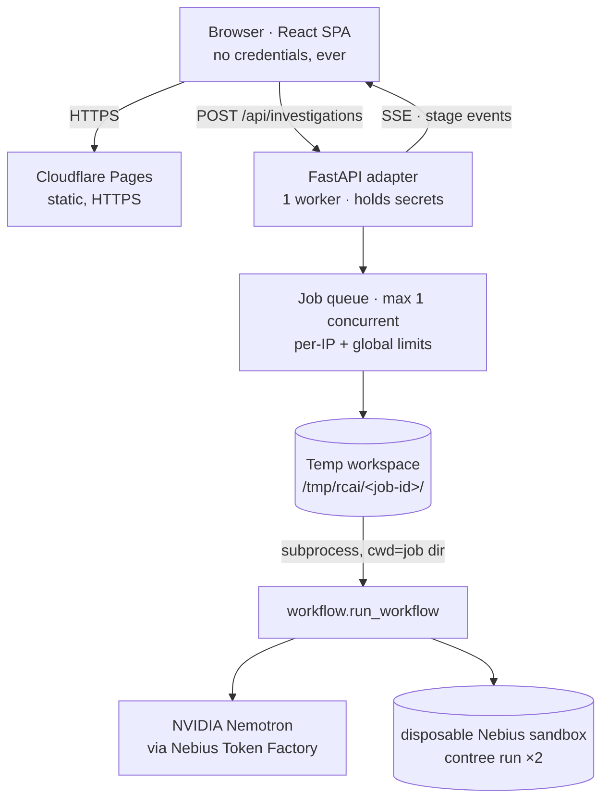

# Phase 2 — Live AI Integration Plan

**Status: proposal only. Nothing implemented, deployed, merged, or modified.**
Branch: `arena/0eaa482c-root-cause-ai` · Date: 2026-10-28

---

## 0. Summary of the recommendation

| Decision | Recommendation |
|---|---|
| Adapter | **FastAPI in a new `api/` directory.** Imports `workflow.run_workflow` — the existing Python files stay byte-identical. |
| Execution model | **One subprocess per investigation**, each in its own temp copy of the repo. No shared mutable state, no concurrency corruption. |
| Progress | **Stream the backend's existing stdout.** It already prints stage markers; no backend change needed. |
| Frontend change | `web/` only: theme tokens, a live/replay badge, transport already written. |
| Hosting | **Static site on Cloudflare Pages + API container on Fly.io** (or a single small VPS if you prefer one bill). Streamlit Cloud keeps serving the old app untouched. |
| Cost at 1,000 investigations | **≈ $0.53** (Nemotron Nano) to **≈ $2.24** (Nemotron Super 120B) in inference, plus sandbox compute (unpriced publicly — see §9) and ~$0–7/month hosting. |
| Biggest risk | Not code execution — **cost abuse**, because a public no-login endpoint spends your Nebius credits. Mitigated by hard caps (§7). |

---

## 1. What I verified about the backend (facts, not assumptions)

| Behaviour | Evidence | Consequence for Phase 2 |
|---|---|---|
| `run_workflow(scenario_id)` returns a dict and **never raises** | `workflow.py:113-124`; probed: unknown/broken runs return `verified: False`, `verdict: None` | Adapter must interpret missing verdicts, not catch exceptions |
| `workflow.ROOT = Path(__file__).resolve().parent`; all reports write beside the source | `workflow.py:9`; probed: `workflow.ROOT` resolves to whatever directory it is imported from | **A temp copy isolates every run.** Confirmed working |
| Stage 1 is pure arithmetic, ~**0.4 ms**, no credentials | probed directly | Can be served instantly and honestly as "live" |
| `nemotron_client.py` and `patch_generator.py` read `NEBIUS_*` at **import time** and `raise RuntimeError` if absent | `nemotron_client.py:12-28`, `patch_generator.py:11-15`; probed: child exits instantly with a traceback | Credentials must exist in the child's env before any import; failure is fast and loggable |
| Child scripts print rich stage markers (`Checking Nebius Sandbox authentication…`, `Baseline:`, `Testing AI repair in Nebius Sandbox…`, `Final verdict:`, `… verified!`) | grep over all three repair scripts | **Real progress streaming without modifying the backend** |
| Reports are **inconsistent across scenarios** | refund report says `scenario_id: "refund_sign_error"`; only duplicate has `elapsed_seconds` and `baseline_passed`; precision has neither | A normaliser is mandatory (§4) |
| Sandbox verification shells out to `contree` (PyPI `contree-cli` 0.9.4, Python ≥3.10) | `sandbox_verifier.py:24-70`; PyPI metadata checked | Installable in a normal container — no exotic runtime |
| AI-generated code is **only ever executed inside `contree`** | `prepare_sandbox_tests.py` splices into a copy; execution happens in the sandbox | The API host never runs model output locally |
| Timing | `workflow` timeout 600 s, per-sandbox 240 s | Requests must be async; never hold an HTTP request for the whole run |

**Repo health found while inspecting (fixed, committed `1096802`)**

- The root `.gitignore` line `lib/` was silently excluding `web/src/lib/` — 7 core frontend modules. GitHub had the UI but not its logic; a fresh clone could not build. Restored and re-included.
- Still open (not changed, needs your OK): `precision_verification_bundle/`, `precision_verification_report.json` and `precision_proposed_patch.json` are **not** in `.gitignore`, unlike their duplicate/refund counterparts. The temp-workspace design sidesteps this, but adding the three patterns would keep a dev machine clean.

---

## 2. Architecture



### 2.1 Why a subprocess, not an in-process call

`run_workflow` is safe to import, but three things make in-process reuse fragile:
`patch_generator` fails at import without credentials, `sys.path` must point at the job
directory, and module-level state (`ROOT`) is fixed per interpreter. Launching:

```
python -c "import json,sys; from workflow import run_workflow; print(json.dumps(run_workflow(sys.argv[1])))"
    (cwd = /tmp/rcai/<job-id>, PYTHONUNBUFFERED=1, env = server env)
```

gives per-job isolation of imports, paths, crashes and stdout — and mirrors how the
project already runs. `PYTHONUNBUFFERED=1` is inherited by the grandchild `contree`
process, which is what makes streaming work.

### 2.2 Per-run workspace

```
/tmp/rcai/<job-id>/
├── *.py, .streamlit/          ← copied from the repo (read-only source)
├── proposed_patch.json        ← written by the child
├── <scenario>_verification_report.json
└── <bundle>/                  ← disposable, deleted after the run
```

Deleted in a `finally` block. Proven: `workflow.ROOT` resolves inside the copy, so
concurrent runs cannot collide and the checked-out repo is never written to.

### 2.3 Frontend changes (Phase 2 scope in `web/`)

| Change | Files |
|---|---|
| `VITE_API_MODE=live` path already exists | `src/lib/api.ts` (no edit needed) |
| Live vs replay badge, provenance wording, error + queue states | `DemoBanner`, `InvestigationWorkspace`, `ProvenancePanel` |
| Light/dark theme (§6) | `styles/global.css` + token pass across 21 components |
| Graceful fallback when API is unreachable → replay, clearly labelled | `api.ts` |

---

## 3. API contract

```
GET  /api/health                     → { ok, live_enabled, sandbox_ready, queue }
GET  /api/scenarios                  → 3 scenarios (id, title, testCount, sourceFile)
POST /api/investigations             → 202 { id, position }   body { scenario_id }
GET  /api/investigations/{id}        → 200 InvestigationResult | 202 { status } | 404
GET  /api/investigations/{id}/events → text/event-stream (stage, log, result, error)
GET  /api/investigations/{id}/artifacts/{name}
                                     → whitelisted only: original.py | candidate.py | report.json
```

`InvestigationResult` is the **existing TypeScript interface** in `web/src/lib/contract.ts`.
Phase 2 adds nothing to it except `mode: "live"` and nullable fields already declared.

Every response is validated through a Pydantic model on the way out, so the contract can
drift in neither direction silently.

---

## 4. Normalisation (the part that will otherwise break the UI)

| Raw backend | Problem | Adapter behaviour |
|---|---|---|
| refund report `scenario_id: "refund_sign_error"` | Does not match the registry id | Map to `incorrect_refund` |
| duplicate report has `baseline_passed`, others do not | Inconsistent shape | Compute `passed = ran − failed` |
| `elapsed_seconds` only in duplicate | Absent elsewhere | `null` → UI shows "—", never `0` |
| per-test names only inside log text | UI needs a matrix | Adapter derives them — see §4.1 |
| patch JSON keys differ (`proposed_code` vs bundles) | — | Normalise to `PatchProposal` |
| `verdict` can be absent on failure paths | `None` | Explicit `"error"` + surfaced log tail |

### 4.1 Deriving the per-test matrix honestly

The candidate's per-test results are parsed from the sandbox logs that the backend already
returns (`final_passed`, `final_failed` plus the unittest verbose output). For the **baseline**
column the adapter runs the scenario's own test file once against the untouched copy in the
temp workspace (`python -m unittest`, no AI, ~10 ms) and records the real per-test outcome.

The UI label becomes: *"baseline measured locally by the adapter · candidate measured inside
the Nebius sandbox"* — accurate, and still reproducible.

---

## 5. Progress streaming

`POST` creates a job and returns an id immediately. The client opens
`GET /events` (SSE). The adapter tails the child's stdout line by line and maps markers to
stage transitions:

| Marker seen in stdout | Stage event |
|---|---|
| `ROOTCAUSE AI - … INVESTIGATION` / `[2/4]` | `diagnose: running` |
| `Patch passed structural validation` / `[3/4]` | `repair: done` |
| `Checking Nebius Sandbox authentication…` | `verify: running` |
| `Final verdict:` | `verify: done` |
| child exit | `result` |

Client-disconnect cancels the job. A 15 s `: keepalive` comment prevents proxy timeouts,
and a `GET /investigations/{id}` poll remains available as the fallback the frontend already
knows how to use.

---

## 6. Light / dark mode

**Feasible because the tokens are already variables.** Verified in the built CSS:

```
.bg-navy-950{background-color:var(--color-navy-950)}
.text-ink{color:var(--color-ink)}
```

So a theme is a second palette on `html[data-theme="light"]`, no component rewrite.

**Scope, measured:**

| Item | Count |
|---|---|
| `white/N` border/overlay utilities hardcoded to a dark ground | **119 occurrences in 21 files** |
| `text-white` headings | 33 |
| hardcoded hex in TSX | 3 |
| semantic ink tokens (already correct) | 182 |

Plan: introduce `--color-hairline`, `--color-surface`, `--color-surface-raised`,
`text-strong`, and a `.dark`/`.light` token block; mechanically replace the 119 + 33
occurrences; then visually QA all six pages in both themes. Persist in `localStorage`,
default to `prefers-color-scheme`, and set the attribute from an inline script before first
paint so there is no flash. Toggle goes in the header next to the mode badge.

Honest estimate: **the largest single piece of frontend work in Phase 2** — not because it is
hard, but because 152 call sites need checking for contrast in light mode.

---

## 7. Security

### Threat model (public, no login)

| # | Threat | Control |
|---|---|---|
| 1 | **Spend abuse** — anyone triggers paid inference + sandbox runs | Per-IP limits (3/hour, 20/day), global concurrency 1, global daily cap, `LIVE_RUNS_ENABLED` kill switch, optional 10-min result cache, Cloudflare Turnstile if abused |
| 2 | **Arbitrary code submission** | Impossible by construction: `scenario_id` is an enum of three fixed values. No user-supplied code, paths or prompts reach the pipeline |
| 3 | **AI-generated code escaping the sandbox** | Model output is written to a temp copy and executed only by `contree run` in a disposable VM. The API host never executes it |
| 4 | **Credential exposure** | Secrets only in the API process env. No `VITE_` secret, ever. Logs pass through a redactor before leaving the server. Response bodies are scanned in tests for the key prefix |
| 5 | **Path traversal on artifacts** | Static whitelist of three filenames per job; the id is a server-generated ULID validated by regex |
| 6 | **Cross-run data bleed** | Unique temp dir per job; asserted by a concurrency test |
| 7 | **DoS / slow runs** | 600 s workflow cap, 240 s per sandbox, one worker, bounded queue returning `429`, temp dirs cleaned in `finally` |
| 8 | **Container escape / pivot** | Non-root user, read-only root fs except `/tmp`, no Docker socket, egress limited to Nebius endpoints |
| 9 | **CORS / origin abuse** | Allowlist exactly the site origin; no wildcard |
| 10 | **Prompt injection via repo content** | Not reachable — the user cannot influence the prompt; the source file is ours |

**Non-negotiables carried from your constraints:** backend files untouched, regression tests
untouched, Streamlit deployment untouched, `main`/`Juliana`/`integration-juliana` untouched,
no credentials in the browser or in git.

---

## 8. Hosting

**Requirements, measured from the code:** Python ≥3.10 (3.12 preferred), outbound HTTPS to
`api.tokenfactory.nebius.com` and the Nebius sandbox API, a writable `HOME` for
`contree auth --type iam`, `pip install contree-cli`, long-lived process, SSE without
buffering, persistent enough `/tmp` for a 600 s job.

| Option | Frontend | API | Verdict |
|---|---|---|---|
| **A. Cloudflare Pages + Fly.io** (recommended) | free, global CDN, HTTPS | `shared-cpu-1x`, 512 MB, ~$3–5/mo | Best split of cost and reliability; scale-to-zero is fine with the queue |
| B. Cloudflare Pages + Render | free | Starter ~$7/mo | Simpler UI, slightly pricier, free tier sleeps |
| C. Single VPS (Hetzner CX22) + Caddy | same box | same box | One bill, no cold starts, full egress control — good if you want it simple |
| D. Streamlit Cloud | — | — | **Cannot host the API** (no CLI, no long-lived worker) |

Public HTTPS with **no visitor login** is satisfied in all three viable options: access is
anonymous, and abuse is controlled by rate limits rather than authentication.

**Your existing Streamlit demo keeps running unchanged** on Streamlit Cloud at its current URL;
it is a separate deployment and Phase 2 does not touch it.

---

## 9. Cost model

### Inference (published Nemotron prices, per 1M tokens)

| Model | Input | Output |
|---|---|---|
| Nemotron 3 Nano 30B A3B | $0.06 | $0.24 |
| Nemotron 3 Super 120B | $0.30 | $0.90 |
| Nemotron 3 Ultra 550B | $1.00 | $3.00 |

Per investigation worst case (diagnosis + two patch attempts, measured prompt sizes ≈ 3,550 in / 1,300 out):

| Model | Per run | 1,000 runs | 10,000 runs |
|---|---|---|---|
| Nano 30B | **$0.00053** | **$0.53** | $5.30 |
| Super 120B | **$0.0022** | **$2.24** | $22.40 |

Inference is effectively free at demo scale. The 10-minute cache and the daily cap exist to
bound worst-case behaviour, not to save meaningful money.

### Sandbox compute

Each investigation performs **two** `contree run` invocations of `python:3.12-slim`, typically
1–10 s each. I could **not** find published per-second sandbox pricing in the material I can
reach from this environment, so I am not going to invent a figure. **Action: check your Nebius
console for the actual metered rate before we set the daily cap** — it is the only cost driver
here that is not already known.

### Hosting

$0–7/month total. Pages is free; the API is a small always-available container.

---

## 10. Testing strategy

| Layer | What it proves | How |
|---|---|---|
| **Unit** | Normaliser handles all three report shapes, including `refund_sign_error` and missing `elapsed_seconds`; redactor removes secrets; ULID validation; rate limiter maths | pytest, fixture-driven (fixtures are the recorded Phase 1 reports) |
| **Contract** | API output conforms to `InvestigationResult` | Pydantic model + a parity test against `web/src/lib/contract.ts` |
| **Adapter integration (no credentials)** | Stage parsing, normalisation, temp isolation, cleanup | Put a **fake `contree`** executable on `PATH` that emits unittest-style output; run the full job end to end offline |
| **Concurrency** | No cross-run bleed | 10 parallel jobs → distinct dirs, distinct reports, all cleaned |
| **Abuse** | Limits actually engage | 50 rapid POSTs → expect `429`/queue, never 50 sandbox runs |
| **Security** | No secret leaks; no traversal | Scan every response body for the key prefix; request `artifacts/../../etc/passwd` → 404 |
| **Live (gated, manual)** | The real thing works | `RC_LIVE=1` runs one investigation per scenario against Nebius; asserts verdict + test counts. Not in CI (costs money, needs secrets) |
| **Frontend** | UI still renders; live path works | Existing `npm run smoke` + `smoke:panels`; add a mocked-`EventSource` test for the live branch |
| **Regression** | Nothing existing broke | `python -m unittest test_workflow test_scenario_registry`; Streamlit app still boots; `git diff` touches no `.py` outside `api/` |

The fake-`contree` trick is the key one: it lets the entire adapter be tested in CI with no
credentials and no spend.

---

## 11. Rollout, with approval gates

| Milestone | Deliverable | Gate |
|---|---|---|
| **M0** | This plan | **← you are here** |
| **M1** | `api/` skeleton: health, scenarios, job queue, temp workspace, normaliser, redactor. Replay passthrough only | Review; no live traffic yet |
| **M2** | Live execution + SSE stage streaming against a real Nebius run, local machine only | You confirm one real verified run per scenario |
| **M3** | Light/dark mode in `web/` + live/replay badges + queue/error states | Visual review in both themes |
| **M4** | Hardening: limits, cache, kill switch, container image, egress rules | Security checklist signed off |
| **M5** | Deploy to Pages + container host behind the kill switch, live runs OFF | **Your explicit go-ahead** |
| **M6** | Enable live runs with conservative caps, watch for a day | Your call on raising caps |

**Rollback** at any point: `LIVE_RUNS_ENABLED=0` instantly reverts the site to labelled replay;
the static site and Streamlit app are unaffected either way.

---

## 12. What I need from you before M1

1. **Model id** — what is `NEBIUS_MODEL` set to? It changes cost by ~4× and quality noticeably.
2. **Sandbox access** — confirm `contree` runs against your project from a clean machine, and
   whether you know the metered rate (§9).
3. **Hosting** — A (Pages + Fly), B (Pages + Render), or C (single VPS)? And who owns the account.
4. **Caps** — are 3 runs/IP/hour, 20/day and 200/day global acceptable to start?
5. **Theme default** — light, dark, or follow the OS preference?
6. **Two small `.gitignore` additions** for the precision artifacts (§1) — yes/no.

I will not create `api/`, touch any existing `.py`, deploy, or merge until you answer.

---

## 13. Constraint compliance

| Requirement | Status in this plan |
|---|---|
| Live investigations via `run_workflow` | Imported unchanged; executed in an isolated temp copy |
| NVIDIA Nemotron via Nebius | Existing integration preserved; no key touches the browser |
| AST validation, regression tests, sandbox verification | All three left exactly as they are; results only read and normalised |
| Three scenarios | Enumerated server-side; no free-form input |
| Light/dark toggle with persistence | Planned, with the 152 call sites measured |
| Replay preserved and labelled | Yes — and it becomes the fallback if the API is down |
| Public HTTPS, no visitor login | Pages + container host |
| API keys backend-only; no unrestricted AI code execution | §7, threats 2–4 |
| Branch safety | Only `arena/0eaa482c-root-cause-ai` |
| Streamlit + existing logic preserved | Untouched; separate deployment |
